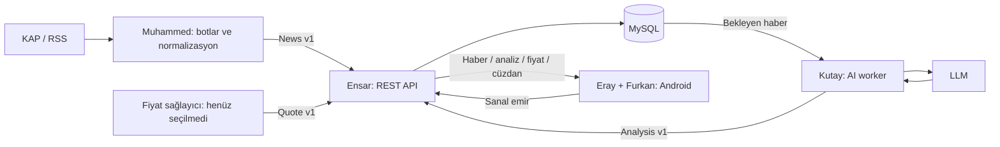

# Finance Expert - mimari v1 taslağı

Tarih: 20 Ekim 2026.
Durum: Ekip incelemesine hazır tasarım; uygulama ve ekip kabulü bekleniyor.
İncelenen repo: `b3c18e7823530d1a4f5559441130b634b1e9e1b2`.

## Mevcut durum

`Web_scaper/kap_scraper.py`, Playwright ve BeautifulSoup ile KAP bildirimlerini
yerel JSON listesine yazar. `Web_scaper/blmbrght.py`, feedparser ile RSS okur,
anahtar kelime filtresi uygular, bağlantıya göre tekrarları ayıklar ve yerel JSON'a
yazar. Kodda bekleme süresi 300 saniyedir; üstteki 30 dakika yorumu güncel değildir.
KAP kaydında yayın/çekim zamanı yoktur; Bloomberg çekim zamanı saat dilimsizdir.
Backend, MySQL, Android ve AI modülleri incelenen commit'te yoktur.

## Hedef yapı

Proje sorumlusu katmanlar arası sözleşme ve entegrasyonu koordine eder.
Şükrü sanal işlem kurallarını ve finansal senaryoları doğrular.

## Bileşen sınırları

| Bileşen | Sorumlu | Girdi | Çıktı |
| --- | --- | --- | --- |
| Botlar ve adaptör | Muhammed | KAP HTML, RSS | Normalize ve doğrulanmış News |
| AI worker | Kutay | News kimliği, başlık, özet, eşleşmiş semboller | Doğrulanmış Analysis |
| REST API ve veri tabanı | Ensar | News, Analysis, Quote, sanal emir | Kalıcı kayıt ve kullanıcı yanıtları |
| Android veri katmanı | Eray | REST yanıtları | Retrofit modelleri, Room önbelleği |
| Android arayüz | Furkan | Veri katmanı modelleri | Haber, grafik, sanal cüzdan ekranları |
| Finansal kontrol | Şükrü | Temsili işlem senaryoları | Kâr/zarar ve hata senaryosu kabulü |

Backend framework'ü, LLM modeli, fiyat sağlayıcısı ve kullanıcı oturum yöntemi
bu pakette seçilmemiştir. Docker servisleri için öneri: API, MySQL, AI worker;
botlar ayrı zamanlanmış süreçlerdir. İlk fazda mesaj kuyruğu yerine MySQL'de
iş durumu tablosu yeterlidir. Servislerin uygulanması ilgili modül sahibindedir.

## Haberden ekrana akış

1. Bot kaynağı okur ve ham çıktıyı korur. Adaptör ortak News v1 üretir.
2. Backend şemayı doğrular; `news_id` üzerinden aynı haberi tekrar oluşturmaz.
3. News kaydı ve `pending` analiz işi aynı transaction içinde kaydedilir.
4. Worker işi atomik olarak `processing` durumuna geçirip süreli kilit alır.
5. Worker LLM çıktısını Analysis şemasına ve News bağlantısına göre doğrular.
   Haber içeriği model talimatı olarak kullanılmaz. HTML ve betikler temizlenir.
6. Başarılı çıktı kaydedilir ve iş `completed` olur. Hatalı çıktı ekrana verilmez;
   en fazla 3 denemeden sonra `failed` olur. Süresi dolan kilit tekrar alınabilir.
7. Android haberleri analizden bağımsız gösterir; bekleyen analiz için durum metni
   kullanır. Fiyat bulunamazsa grafik boş durum gösterir ve sanal emir kabul edilmez.

## Veri modeli önerisi

| Tablo | Anahtar / ilişki | Kritik kural |
| --- | --- | --- |
| news | PK news_id | Kaynak kimliğine göre tekrar engeli |
| news_symbols | PK (news_id, symbol) | FK news_id; semboller ana listeden doğrulanır |
| analysis_jobs | PK news_id | FK news_id; status, attempts, locked_until |
| analyses | PK analysis_id, FK news_id | prompt_version ve model saklanır |
| quotes | PK (symbol, as_of) | currency ve provider saklanır |
| wallets | PK wallet_id, kullanıcı ilişkisi | Para DECIMAL; nakit negatif olamaz |
| positions | PK (wallet_id, symbol) | quantity tam sayı, average_cost DECIMAL |
| trades | PK trade_id, FK wallet_id | UNIQUE (wallet_id, idempotency_key) |

JSON'da parasal değerler ondalık metindir; MySQL tarafında DECIMAL kullanılır.
Ham JSON arşivleri, .env, servis anahtarları ve kullanıcı verisi Git'e eklenmez.
Android yalnız API'ye erişir; MySQL ve LLM anahtarı istemciye verilmez.
İç veri yazma uçları servis kimliğiyle, cüzdan uçları kullanıcı oturumuyla korunur.
API her cüzdan isteğinde sahipliği kontrol eder; istemciden fiyat veya bakiye kabul etmez.

## Hata ve gözlemlenebilirlik

Bot kesintisi eski haberi silmez. Her döngüde kaynak, başarı/hata, yeni kayıt sayısı
ve çalışma süresi loglanır. API `request_id` ile hata döndürür. LLM hata loglarında
anahtarlar ve kullanıcı bilgileri bulunmaz. Fiyat zamanı kullanıcıya gösterilir.
API veri tabanına bağlanamazsa hazır olma kontrolü başarısız olur.

## İlk entegrasyonun kabul koşulu

Tek bir temsili News kaydı API'ye verilir, aynı kayıt tekrarlandığında çoğalmaz,
ona bağlı Analysis kaydı Android modeline okunur. AI kapalıyken haber listesi
çalışır. Eski fiyatla veya yetersiz bakiyeyle sanal emir reddedilir. Bu koşullar
henüz uygulama üzerinde sınanmamıştır; bu haftanın doğrulaması JSON sözleşmesidir.
