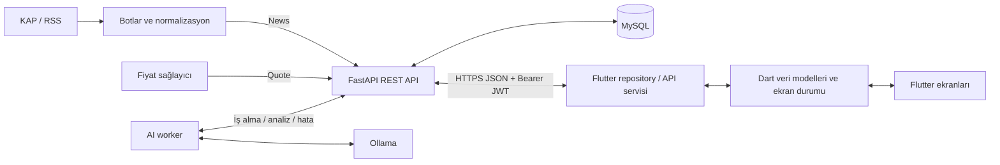

# Finance Expert - sistem mimarisi

Güncelleme: 2 Kasım 2026. Mobil istemci Flutter/Dart'tır.

## Mevcut bileşenler

- `mobile/finance_expert`: Flutter ekranları (giriş, ana sayfa, piyasa, cüzdan, profil).
  Pubspec'te henüz HTTP veya kalıcı önbellek paketi yoktur; ekranların bulunması API
  entegrasyonunun tamamlandığı anlamına gelmez.
- `backend/main.py`: FastAPI REST API, kullanıcı kaydı/girişi, JWT, haber/analiz,
  fiyatlar, sanal işlemler ve yeni okuma uçları.
- `backend/database.py`, `database/finance_expert_schema.sql`: SQLAlchemy/PyMySQL
  bağlantısı ve MySQL şeması. Parasal hesaplar Decimal, depolama DECIMAL.
- `ai/worker.py`: analiz işi alma, sonuç gönderme ve hata bildirme; Docker ortamında
  Ollama servisine bağlanır. Model compose yapılandırmasından seçilir.
- `Web_scaper`: KAP/RSS toplama; kaynak çıktıları ortak News formatına uyarlanmalıdır.
- `docker-compose.yml`: MySQL, backend, Ollama ve AI worker servisleri.

Flutter repository/API servisi ve model katmanı hedef tasarımdır. Native Android
Retrofit/Room/XML yaklaşımı kullanılmaz. Android ve iOS aynı Dart katmanını kullanır.
HTTP istemcisi, state management ve yerel önbellek paketi henüz belirlenmemiştir.

## Flutter veri akışı

1. Widget kullanıcı olayını ekran durumuna iletir; ağ isteğini doğrudan widget içinde yönetmez.
2. Repository, API servisinden JSON alır; Dart modelleri `fromJson` ile doğrulanır.
3. Para alanları String olarak taşınır; sunucu hesap sonucu esas alınır. Grafik
   çizimi için sayıya dönüşüm yapılabilir; bu değerle bakiye/kâr hesabı yapılmaz.
4. UTC zamanları parse edilip yerel gösterime çevrilir. Loading, boş sonuç, hata,
   eski fiyat ve eksik değer ayrı ekran durumlarıdır.
5. JWT oturum katmanından gönderilir; token loglanmaz, düz metin tercihlerine yazılmaz.
   Kullanıcı değişince önceki cüzdan ve işlem önbelleği temizlenir.
6. Sanal emir kullanıcı eylemiyle oluşturulur. AI analizi emir tetiklemez.

## Yeni okuma uçları

| Ekran | Uç | Gösterim |
| --- | --- | --- |
| Piyasa / hisse detayı | GET /api/v1/stocks/{symbol}/history | Zaman sıralı son fiyat noktalarından çizgi grafik |
| Cüzdan işlem listesi | GET /api/v1/wallets/{wallet_id}/trades | Limit/offset sayfalama, en yeni işlem önce |
| Cüzdan özeti | GET /api/v1/wallets/{wallet_id}/valuation | Nakit + fiyatlanmış pozisyonlar, güncellik ve eksik fiyat uyarıları |

Portföy uç noktası canlı fiyat aboneliği değildir; son kayıtlı fiyatlarla anlık
istek sırasında hesap yapar. Eksik toplam null gösterilir; sıfır gibi sunulmaz.
WebSocket veya sürekli güncelleme bu teslimin kapsamında değildir.

## Güvenlik ve analiz

Flutter yalnız API'ye erişir; MySQL, servis API anahtarı ve LLM istemciye açılmaz.
Cüzdan uçları JWT ve sahiplik kontrolü kullanır; başka kullanıcıya ait cüzdan 404 döner.
İç yazma uçları servis anahtarıyla korunur. Gerçek fiyat ve bakiye istemciden alınmaz.
Analiz için hedef sözleşme Analysis v1.1 ve zorunlu uyarıdır; mevcut backend/AI
üreticilerinin bu sözleşmeye tam uyumu ayrı entegrasyon işidir. Haber etkisi dili
ve gösterim kuralları [analiz ilkelerinde](analiz-ilkeleri.md) tanımlıdır.

## CI ve doğrulama sınırı

CI'da `validate-contracts` mevcut şemaları ve AI worker testlerini çalıştırır.
`backend-tests` FastAPI TestClient ile üç okuma ucunu sınar. DB sınırı taklit
edilir: gerçek MySQL sorgu yürütme, transaction/kilitler, Docker, canlı fiyat,
LLM veya Flutter cihaz testi değildir. Backend gerçek HTTP yönlendirmesi,
parametre doğrulaması, oturum gereksinimi, sahiplik sorgusu, hata durumu,
serileştirme ve portföy hesapları sınanır.

Ayrıntılı yeni uç sözleşmeleri: [Okuma uç noktaları](okuma-uc-noktalari.md).

### Bilinen AI sözleşmesi uyumsuzluğu

Bu dokümantasyon dalındaki Analysis v1.1 şemasına göre AI kodu disclaimer ekler.
Mevcut backend AnalysisCreate hâlâ v1.0 ve extra=forbid kullanır; AI worker
sahte backend testi de eski alan listesini kabul eder. Bu yüzden ai/test_worker.py
çalışmasında 3 senaryo 422 nedeniyle başarısızdır. Yeni backend-tests işi bundan
bağımsızdır. AI üreticisi, backend modeli/serileştirmesi ve test çiftinin aynı sürüme
geçirilmesi ayrı entegrasyon işidir; CI'nın tamamı yeşil sayılmamalıdır.
